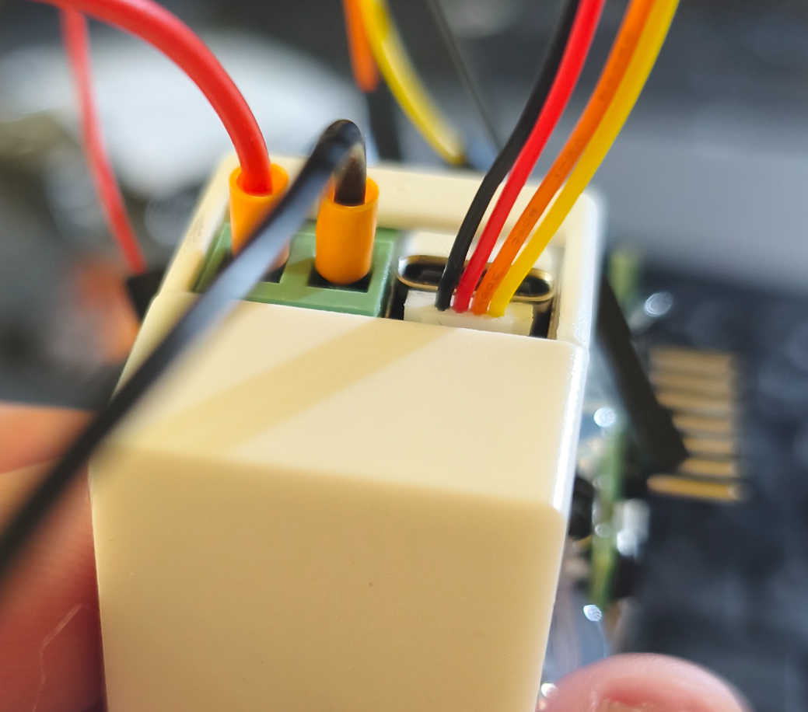

# simppeliTCU 🍃
**A lightweight, open-source DIY replacement for the Nissan Leaf ZE1 Telematics Control Unit (TCU).**

*Read this in Finnish: [README_FI.md](README_FI.md)*

With Nissan shutting down the NissanConnect EV services, `simppeliTCU` offers a local, Wi-Fi-based ESP32 solution to regain control of your car's climate and charging via the IT CAN bus (often referred to as CAR-CAN by the community). Similarly as the original TCU.

**Hardware used in this fork:** Waveshare **ESP32-S3-RS485-CAN**, with an optional **BK-7670 V1 breakout carrying a SIMCom A7670E** for cellular fallback. The wiring below describes this setup; the upstream project uses a LilyGO T-2CAN.

The `waveshare-fallback-wifi` branch includes upstream **v0.2.0**, with the Waveshare CAN pin assignments and this fork's Wi-Fi/LTE, MQTT configuration and Web UI authentication preserved. Remote syslog support has been removed; diagnostics remain available through USB serial, `lte-status` and `mqtt-status`.

NOTE: This project is currently an draft implementation generated mainly with AI.

## Features
* 🌡️ **Remote Climate Control:** Start and active abort of the cabin heater/AC.
* 🔋 **Remote Charging:** Override the charge timer to start charging.
* 🔐 **Door Locking:** Lock and unlock doors remotely (disabled by default, enable via configuration).
* 🔕 **Nag Screen Auto-Dismiss:** Upstream feature for dual-CAN builds connected to AV-CAN; unavailable on the single-CAN Waveshare setup.
* 📊 **Live Data:** Reads State of Charge (SOC %) and Cabin Temperature from the CAN bus.
* 🌐 **Web UI:** Simple, lightweight mobile-friendly web interface.
* 🔑 **Web UI Authentication:** Password-protected controls, configured through the serial CLI.
* 📶 **Preferred Wi-Fi with Fallback:** Primary Wi-Fi, optional secondary Wi-Fi and optional A7670E UART/PPP cellular fallback, with automatic return to Wi-Fi.
* 🏠 **Home Assistant Integration:** Automatic discovery of metrics and controls via MQTT.
* 📡 **MQTT Support:** Integrate with home automation or mobile apps over encrypted transport. Note: unless proper certificate validation is implemented, the MQTT server is not authenticated. See the [MQTT Setup Guide](docs/mqtt.md).

## Operation
* ⚙️ **Non-blocking operation:** The device processes CAN commands asynchronously. If a new command is issued while one is already in progress, it will be safely ignored.


## Videos
* **First trials:** [https://youtu.be/qn05-901b3Y](https://youtu.be/qn05-901b3Y)
* **Web interface through wifi:** [https://youtube.com/shorts/XqAgwizNodE](https://youtube.com/shorts/XqAgwizNodE)
* **MQTT use with IoTMQTTPanel and OVMS Connect:** [https://youtu.be/g8Yh6OgjL-Q?si=QtElrzG9FnF5YEUm](https://youtu.be/g8Yh6OgjL-Q?si=QtElrzG9FnF5YEUm)
* **Glove box removal (LHD ZE1 Leaf):** [https://youtu.be/kyx2A4U-M1M?si=YGewj1TeBEfrpOKV](https://youtu.be/kyx2A4U-M1M?si=YGewj1TeBEfrpOKV)
* **Nag Screen Auto-Dismiss** [https://youtu.be/FWOML1giRBo?si=TElSWKBwn389HtfV](https://youtu.be/FWOML1giRBo?si=TElSWKBwn389HtfV)

## Hardware Requirements

1. **Waveshare ESP32-S3-RS485-CAN**, with an onboard CAN transceiver.
2. Optional **AND BK-7670 V1 / SIMCom A7670E** modem, LTE antenna and active data SIM with the PIN request disabled.
3. For the modem, an **automotive-suitable regulated 5 V supply rated for at least 2 A**, including transmit current peaks.
4. A four-pin **SH1.0 cable**, modem header connections and connectors/pins to mate with the original TCU harness.

The [upstream Installation Guide](docs/INSTALLATION.md) covers the vehicle harness and LilyGO installation. For this fork, use the Waveshare connections below instead of the LilyGO pin assignments.

### ⚠️ CRITICAL WIRING WARNING

The Waveshare screw-terminal power input is rated **7–36 V**, so nominal 12 V connects there, using a fused, automotive-suitable supply. This input rating does not make every automotive transient safe. **Do not connect 12 V to the USB, 3V3, GPIO or modem VCC pins.** The original LilyGO board has different power requirements. [Waveshare hardware documentation](https://docs.waveshare.net/ESP32-S3-RS485-CAN/)

### Waveshare CAN wiring

Disconnect the original TCU's IT-CAN connection and connect the vehicle's **CAN-H to the Waveshare H terminal**, and **CAN-L to the L terminal**. The onboard CAN controller/transceiver uses **GPIO15 for TX and GPIO16 for RX**, selected centrally in `simppeliTCU/hardware.h`. These are internal controller signals; the vehicle CAN pair connects to the **H/L terminals**, not directly to GPIO15/16. This fork defaults to the Waveshare board; LilyGO GPIO7/6 is used only when explicitly selecting `BOARD=LILYGO_T2CAN`.

### A7670E modem wiring through SH1.0

Use the Waveshare's **four-pin GPIO SH1.0 connector**, not the two-pin RTC battery connector. GPIO1 and GPIO2 are assigned to UART1 by the LTE configuration:



*Photo of the Waveshare end of the cable used in this setup. From left to right at the white connector: black = GND, red = 3V3 (unused), orange = GPIO2 / ESP32 RX (to modem T), yellow = GPIO1 / ESP32 TX (to modem R). The modem end is not shown.*

| Waveshare SH1.0 signal | Wire in the cable used for this setup | BK-7670 V1 connection |
| --- | --- | --- |
| **GPIO1 — ESP32 TX** | **Yellow** | **R / RXD**, header pin 5 — modem input |
| **GPIO2 — ESP32 RX** | **Orange** | **T / TXD**, header pin 4 — modem output |
| **GND** | Black | **G / GND**, header pin 1 or 6, unless a common ground is already verified |
| **3V3** | Red | **Leave disconnected and insulate**; not the modem supply |

Cable colors can vary: identify each contact from the board's labels/pinout before connecting it. TX connects to RX in both directions. The BK-7670 breakout provides **3.3 V TTL UART**, compatible with ESP32 GPIO; this does not describe the bare modem module's pins. [Waveshare connector pinout](https://docs.waveshare.net/assets/images/ESP32-S3-RS485-CAN-details-17-962be6f963b528179bb59193896f4ac3.webp), [BK-A7670 manufacturer manual, page 4](https://img.yfisher.com/m0/1692268831380-a7670-series-model-bk-a7670-board-user-manual-v10.pdf#page=4)

Power the breakout's **V / VCC (header pin 2)** from the regulated **5 V / at least 2 A** supply, and its **G / GND** from the supply return. Do not use the SH1.0 red/3V3 wire to power it. The manufacturer recommends 5 V for this breakout. Leave **K/PWRKEY** and **S/SLEEP** unconnected for the documented default startup; the firmware does not control them. [BK-A7670 manufacturer manual](https://img.yfisher.com/m0/1692268831380-a7670-series-model-bk-a7670-board-user-manual-v10.pdf#page=4)

Example supply arrangement with a **non-isolated** step-down converter:

```text
Fused vehicle +12 V ----+---- Waveshare power terminal +
                       +---- Step-down IN+
Vehicle GND -----------+---- Waveshare power terminal -
                       +---- Step-down IN-

Step-down OUT+ (5 V) -------- BK-7670 V / VCC
Step-down OUT- (GND) -------- BK-7670 G / GND
```

UART requires a common logic ground. If the converter's IN- and OUT- are common, the shared supply return can provide it; verify continuity with power disconnected. Otherwise, connect the SH1.0 GND to modem GND. Connect the LTE antenna before powering the modem.

For this GPIO1/2 wiring, enter the following in the **USB serial CLI**, replacing `YOUR_APN` with your provider's APN:

```text
set lte_tx 1
set lte_rx 2
set lte_apn YOUR_APN
set lte_enabled true
reboot
```

Check `lte-status` and `mqtt-status` after reboot. Wi-Fi remains preferred; LTE initialization starts after 20 seconds without a Wi-Fi IP, or immediately if no STA network is configured. See the [4G setup and hardware test procedure](docs/lte.md) for detailed behavior and troubleshooting. Actual APNs, passwords and broker addresses stay in device NVS, not in this README or the firmware source.

## Configuration

The device configuration (Wi-Fi, MQTT credentials, etc.) is stored in persistent memory. You configure the system through the USB serial connection using a terminal (such as the Arduino IDE Serial Monitor, PuTTY, or similar) set to **115200 baud** with Newline (`\n`) or Carriage Return (`\r`) enabled.

Available commands:
* `list` - Shows all current configuration properties (including firmware version).
* `get <key>` - Prints the current value of the specified key.
* `set <key> <value>` - Updates the specified key with a new value (saved persistently).
* `lte-status` - Shows runtime LTE state, active uplink, last error and cached modem diagnostics.
* `mqtt-status` - Shows MQTT connection state, broker, active uplink and last connection result without reconnecting.
* `version` - Prints the current firmware version and git commit hash.
* `reboot` - Restarts the device to apply the changes immediately.
* `factory-reset` - Clears all configuration settings and restarts the device.

**Example configuration session:**
```text
set ssid MyWiFiNetwork
set password MySecretPassword
set fallback_ssid PhoneHotspot
set fallback_password PhonePassword
set ap_ssid LeafLocalAP
set ap_password LeafLocalPassword
set web_password MyWebPassword
set mqtt_server 192.168.1.100
set locking_enabled true
reboot
```

*Supported Configuration Keys:*
* `ssid`, `password` (For connecting to an existing Wi-Fi network / STA mode)
* `fallback_ssid`, `fallback_password` (Optional second STA network; an empty `fallback_ssid` disables fallback)
* `ap_ssid`, `ap_password` (For creating a local Wi-Fi Access Point / AP mode)
* `web_password` (HTTP Basic Authentication password for the Web UI; minimum 8 characters)
* `lte_enabled`, `lte_apn`, `lte_tx`, `lte_rx` (Optional UART/PPP cellular fallback; disabled by default. See [4G setup](docs/lte.md).)
* `hostName`
* `mqtt_server`, `mqtt_port`, `mqtt_user`, `mqtt_password`, `vehicle_id`
* `mqtt_tls` (Enable/disable TLS for MQTT connection; default: `true`)
* `locking_enabled` (Enable door lock/unlock functionality; default: `false`)
* `hass_discovery` (Enable/disable Home Assistant discovery messages; default: `true`)
* `nag_dismiss` (Automatic infotainment nag screen dismissal on AV-CAN; forced off on Waveshare, enabling requires a dual-CAN build and AV-CAN wiring)

**Wi-Fi Modes:**
* **STA Mode:** Active when `ssid` is configured. The device connects to your home/garage Wi-Fi.
  When `fallback_ssid` is configured, it tries the primary network first, then the fallback network after a 10-second attempt. While on fallback, it checks periodically for the primary network and switches back after detecting it twice at least five seconds apart. Wi-Fi settings take effect after `reboot`.
* **AP Mode:** Active when `ap_ssid` is configured. The device broadcasts its own Wi-Fi network (useful when away from home).
* **AP + STA Mode:** Active when both `ssid` and `ap_ssid` are configured. The device will connect to your home Wi-Fi while simultaneously broadcasting its own Access Point.

**Web UI access:** Set `web_password` via USB serial CLI before opening the Web UI. The browser will ask for username `admin` and the configured password. All Web UI controls require authentication. If `web_password` is empty (including after a factory reset), Web UI access is disabled; `set web_password` without a value disables it again. HTTP Basic Authentication does not encrypt credentials, so use the Web UI only on a trusted network and do not expose port 80 to the Internet.

**4G fallback:** With LTE enabled and configured, primary Wi-Fi remains preferred, followed by fallback Wi-Fi, then the modem. The first modem attempt starts after 20 seconds without a Wi-Fi IP (immediately if no STA network is configured). An established PPP session stays on standby; Wi-Fi must be connected for 10 seconds before switching back from LTE. MQTT reconnects on the selected interface using the same broker, credentials and topics. See [4G setup and hardware test procedure](docs/lte.md).

**Remote configuration:** Wi-Fi and LTE settings can be staged over MQTT and saved with a separate apply/reboot request. Passwords are write-only over MQTT. See [MQTT network configuration](docs/remote-configuration.md) for topics, JSON examples and the session/replay protection.

## Compiling and Uploading

### Linux: Waveshare ESP32-S3-RS485-CAN

Run these commands in Bash with Git and [Arduino CLI](https://arduino.github.io/arduino-cli/) installed. The Waveshare firmware has been compiled with **Arduino CLI 1.5.1**, **ESP32 Arduino core 3.3.12** and **PubSubClient 2.8**. The modem uses the ESP32 core's bundled PPP support; Waveshare does not need the MCP2515 library.

**1. Get this fork's Waveshare branch:**

```bash
git clone --branch waveshare-fallback-wifi https://github.com/ZFF85/simppeliTCU.git
cd simppeliTCU
```

If you already have the repository, use your existing checkout on `waveshare-fallback-wifi` and run the following commands from the repository root, which contains the `simppeliTCU/` sketch directory.

**2. Install the ESP32 core and MQTT library as your normal user:**

```bash
arduino-cli core update-index \
  --additional-urls https://espressif.github.io/arduino-esp32/package_esp32_index.json
arduino-cli core install esp32:esp32@3.3.12 \
  --additional-urls https://espressif.github.io/arduino-esp32/package_esp32_index.json
arduino-cli lib install 'PubSubClient@2.8'
```

**3. Compile specifically for Waveshare, with USB serial enabled:**

```bash
arduino-cli compile \
  --fqbn esp32:esp32:esp32s3:CDCOnBoot=cdc \
  --build-path /tmp/simppeli-tcu-flash \
  --build-property "compiler.cpp.extra_flags=-DBOARD=WAVESHARE_ESP32_S3_RS485_CAN -DGIT_HASH_RAW=$(git rev-parse --short HEAD)" \
  simppeliTCU
```

This selects **CAN TX GPIO15 / RX GPIO16** and disables the second CAN interface. The optional modem wiring uses **ESP32 TX GPIO1 / RX GPIO2**, configured separately using the CLI above. The compiled firmware reports its version and commit through the `version` command.

**4. Connect USB and find the serial port:**

```bash
arduino-cli board list
ls -l /dev/ttyACM0
```

The usual port is `/dev/ttyACM0`; replace it in the commands below if yours differs. Automatic board detection may show a generic ESP32 device; use the explicit ESP32-S3 FQBN shown here.

If access is denied, grant your user access to the serial device. A temporary option, with `setfacl` installed, is:

```bash
sudo setfacl -m "u:$(id -un):rw" /dev/ttyACM0
```

This ACL may need to be applied again after reconnecting USB. For persistent access, add your user to the group owning the serial port, typically `uucp` on Arch Linux or `dialout` on Debian/Ubuntu, then log out and back in. Run `arduino-cli` **without sudo**: root has a separate Arduino configuration and may report that the ESP32 platform is not installed.

**5. Upload the compiled firmware:**

Close any serial monitor first, then run:

```bash
arduino-cli upload \
  --port /dev/ttyACM0 \
  --fqbn esp32:esp32:esp32s3:CDCOnBoot=cdc \
  --build-path /tmp/simppeli-tcu-flash \
  simppeliTCU
```

Use the same build path for compilation and upload. Recompile after changing source code; `upload` sends the existing build. Normal uploads preserve configuration stored in NVS; a full flash erase or `factory-reset` clears it.

**6. Open the USB serial console:**

```bash
arduino-cli monitor --port /dev/ttyACM0 --config baudrate=115200
```

Send commands with a newline. Start with `version`, `lte-status` and `mqtt-status`; see [Configuration](#configuration) for Wi-Fi, modem, MQTT and Web UI settings. Press **Ctrl+C** to close the monitor before the next upload.

For Arduino IDE instructions, other boards and host tests, see the [Compiling and Uploading Guide](docs/compiling.md).

## Flashing Pre-compiled Binaries

For instructions on downloading and flashing pre-compiled release binaries (using GUI tools or `esptool`), please refer to the [Pre-compiled Binaries Flashing Guide](docs/flashing.md). See [CHANGELOG.md](CHANGELOG.md) for a history of features and changes in each release.

## The CAN communication
Please see the [CAN Communication Details](docs/can.md) document for information regarding CAN bus messages, commands, known issues, and limitations related to the IT-CAN integration.

### Dual CAN bus support (LilyGO T-2Can)
The firmware supports two CAN interfaces:

1. **Primary CAN (TWAI):** The ESP32's built-in CAN controller (Port B: TX 7, RX 6).
2. **Second CAN (MCP2515):** An external MCP2515 CAN controller connected over SPI, available on the LilyGO T-2Can board.

All outgoing CAN messages are sent on **both** buses, and incoming messages received on **either** bus are processed identically. This allows the device to be connected to two separate CAN buses at the same time. e.g. IT CAN and AV CAN.

The second CAN interface is enabled by default **only when building for LilyGO** and requires the `autowp-mcp2515` library (see the [Compiling and Uploading Guide](docs/compiling.md)). It can be disabled with the compiler flag `-DUSE_SECOND_CAN=0`. Waveshare builds force it off and do not require this library. Pin assignments for both CAN interfaces (TWAI and MCP2515) are configured centrally in `simppeliTCU/hardware.h`.

## License & Disclaimer (MIT License)
This project is licensed under the MIT License. 

**DISCLAIMER OF LIABILITY:**
This software and hardware modification interacts with the high-voltage control systems of a vehicle. It is provided "AS IS", without warranty of any kind, express or implied. By using this code, you assume all risks. The authors or contributors will NOT be held liable for any damage to your vehicle, voided warranties, property damage, or personal injury resulting from the use of this software or hardware. **USE AT YOUR OWN RISK.**

## Credits
* Inspired by the incredible work of the [OVMS Project](https://github.com/openvehicles/Open-Vehicle-Monitoring-System-3) and [Dalathegreat](https://github.com/dalathegreat) (Dala's EV Repair) for documenting the Nissan Leaf CAN buses.
